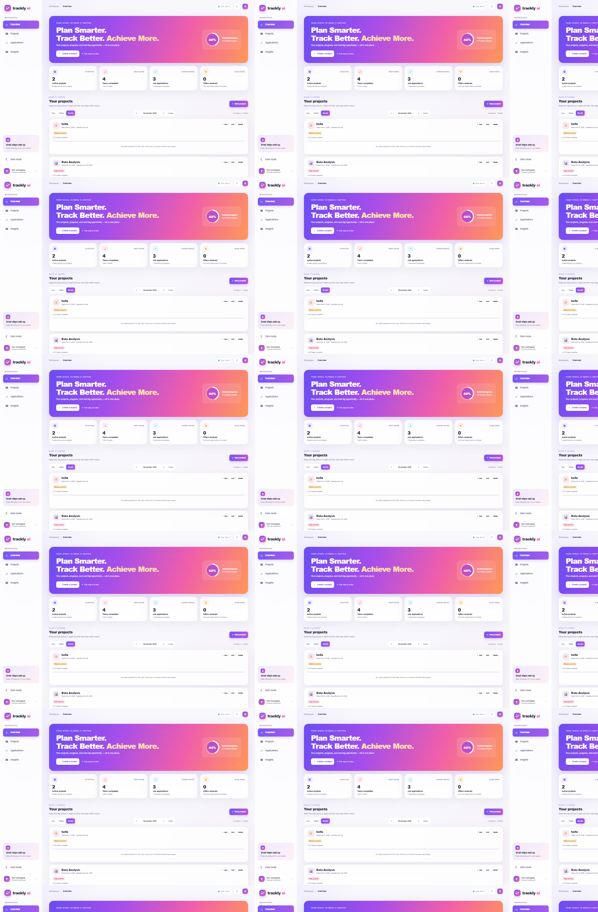
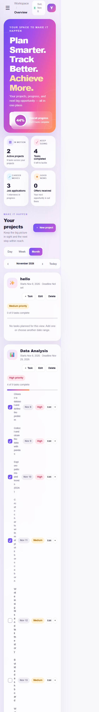

# Trackly AI

**Plan Smarter. Track Better. Achieve More.**

Trackly is a local-first productivity and career dashboard for project planning, task management, job applications, and career learning. It uses Flask and SQLite, keeps the colorful Trackly interface, and stores each account's data in a local database.

> The Career Assistant runs locally. It uses a small skill vocabulary with optional scikit-learn TF-IDF ranking and transparent heuristic recommendations; it does not call a paid or hosted generative-AI API.

## Features

- Create an account with a name, unique email, and validated password; passwords use Werkzeug hashing, with Flask-Login sessions and CSRF protection.
- Sign in using an email address or an existing username, with optional Remember Me.
- Explore an isolated demo workspace using the prefilled demo login; demo projects, tasks, milestones, applications, and analytics are separate from registered users.
- Keep projects, tasks, applications, and career profiles private to the signed-in account.
- Plan projects with start dates, deadlines, and priorities; manage tasks through day, week, or month views.
- Track To Do, In Progress, and Completed work with a drag-and-drop Kanban board and calculated progress.
- View a monthly or weekly calendar of task due dates, project deadlines, milestones, and interview dates.
- Receive in-app reminders for deadlines in the next seven days and overdue tasks; mark reminders as read.
- Review live dashboard totals, application pipeline, project progress, overdue work, and weekly/monthly completion trends.
- Use local career-goal matching, skill-gap recommendations, learning roadmaps, resume-text structure feedback, and interview practice questions.
- Switch between light and dark themes; use responsive desktop and mobile layouts.
- Keep existing unowned project and application records: the first account created adopts legacy rows. Later accounts receive separate editable starter examples.

## Technology and cost

- Python 3, Flask, Flask-Login, Flask-WTF, SQLite, HTML, CSS, and vanilla JavaScript
- Chart.js bundled locally under its MIT license
- scikit-learn for optional local TF-IDF matching; keyword matching remains available without it

All components are free and open source. No paid API, API key, account, hosting provider, domain, subscription, or usage-based billing is required. The dashboard assets work offline after Python dependencies have been installed. Do not expose the Flask development server to the public internet.

## Install and run (Windows PowerShell)

Open PowerShell and run:

```powershell
cd "C:\Users\hirti\Documents\Projects\Data Analysis\trackly"
py -3 -m venv .venv
.\.venv\Scripts\Activate.ps1
python -m pip install --upgrade pip
python -m pip install -r requirements.txt
python app.py
```

If PowerShell blocks virtual-environment activation, run:

```powershell
cd "C:\Users\hirti\Documents\Projects\Data Analysis\trackly"
py -3 -m venv .venv
.\.venv\Scripts\python.exe -m pip install -r requirements.txt
.\.venv\Scripts\python.exe app.py
```

Open [http://127.0.0.1:5000](http://127.0.0.1:5000). Stop the server with **Ctrl+C**. On the first run, Trackly creates `trackly.db` and a random signing key in `instance\secret_key`; both are ignored by Git. Keep these files private and back up the database if its data matters.

## Demo account

The login page is prefilled with the public portfolio demo credentials:

- Email: `demo@trackly.ai`
- Password: `TracklyDemo2026!`

The demo account is created in SQLite with a hashed password and sample workspace data. Its credentials are intentionally public and must never be reused for a personal account. Demo records are isolated from registered accounts.

To re-seed the demo account without deleting its current workspace data:

```powershell
.\.venv\Scripts\python.exe -m flask --app app seed-demo
```

To reset only the demo workspace to its starter sample data (registered accounts and their records are not affected):

```powershell
.\.venv\Scripts\python.exe -m flask --app app seed-demo --reset
```

## Test

From the `trackly` folder:

```powershell
.\.venv\Scripts\python.exe -m unittest discover -s tests -v
```

The tests use temporary SQLite databases and cover registration validation, hashed passwords, login/logout, Remember Me, demo seeding/reset, CSRF, data isolation, project/task/application CRUD, analytics, calendar events, milestones, reminders, local career features, legacy database migration, and persistence across app instances.

## Main API routes

All `/api` routes except `/api/health` require a signed-in user. Unsafe HTTP requests require a valid CSRF token. Browser requests include the token automatically; API clients should load the dashboard or auth form and send the token in an `X-CSRFToken` header.

| Method | Route | Purpose |
|---|---|---|
| `GET` | `/api/health` | Check Flask and SQLite connectivity |
| `GET` | `/api/dashboard` | Read project summaries, real task totals, and analytics |
| `GET`, `POST` | `/api/projects` | List or create projects |
| `PUT`, `DELETE` | `/api/projects/<id>` | Edit or delete a project |
| `GET`, `POST` | `/api/projects/<id>/tasks` | List or create a project's tasks |
| `PATCH`, `DELETE` | `/api/tasks/<id>` | Update status, title, priority, or due date; delete a task |
| `GET`, `POST` | `/api/applications` | List or create job applications |
| `PATCH`, `DELETE` | `/api/applications/<id>` | Update or delete an application |
| `GET` | `/api/calendar?start=YYYY-MM-DD&end=YYYY-MM-DD` | Read calendar events in a date range |
| `POST`, `PATCH`, `DELETE` | `/api/milestones` and `/api/milestones/<id>` | Manage project milestones |
| `GET` | `/api/notifications` | Read and refresh persisted reminders |
| `PATCH` | `/api/notifications/<id>` | Mark a reminder as read |
| `GET`, `PUT` | `/api/career/profile` | Read or update the signed-in user's career profile |
| `POST` | `/api/career/analyze` | Generate local skill matching and a learning roadmap |
| `POST` | `/api/career/resume-review` | Analyze pasted resume text without saving it |
| `GET` | `/api/career/interview-questions?role=...` | Get role-specific practice questions |

## Project layout

```text
trackly/
├── app.py
├── career_assistant.py
├── requirements.txt
├── README.md
├── .gitignore
├── templates/
│   ├── auth.html
│   ├── career.html
│   └── index.html
├── static/
│   ├── css/style.css
│   └── js/
│       ├── app.js
│       └── vendor/
│           ├── chart.umd.js
│           └── LICENSE.chartjs.md
├── tests/test_app.py
├── screenshots/
└── trackly.db       # generated locally; excluded from Git
```

The original standalone `index.html` in the parent folder has not been replaced. A backup of that file is also kept in the parent folder.

## Screenshots





## Deployment notes

The supported configuration is localhost-only at `127.0.0.1:5000`. The Flask development server and local SQLite file are intended for personal use, not public production hosting. GitHub Pages cannot run a Flask backend or provide a persistent SQLite database. Any free third-party hosting tier may sleep, impose limits, or have ephemeral storage; do not upload private data, and verify current limits yourself before using one. This project configures no hosting service or billing.
